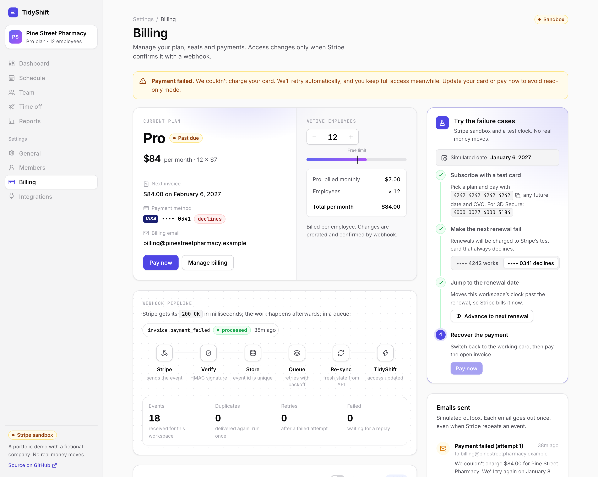
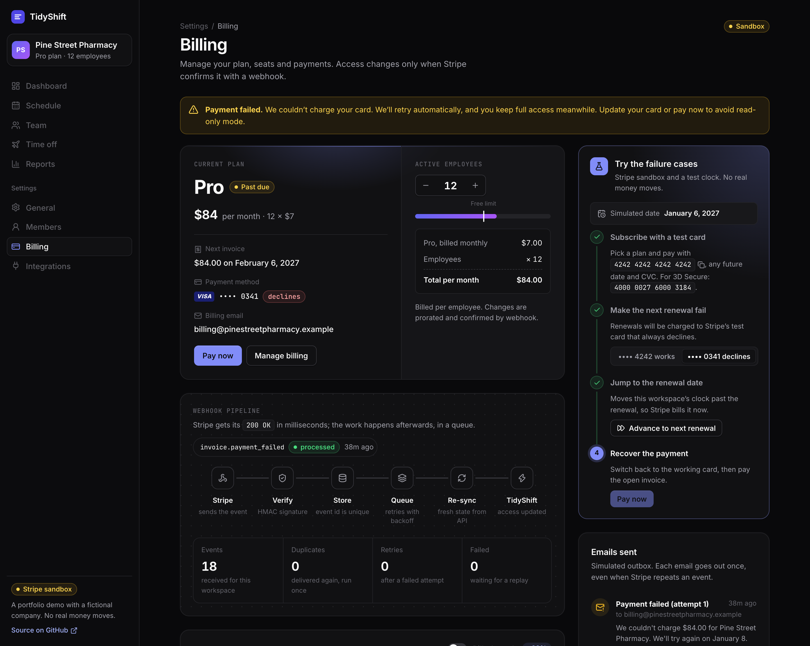
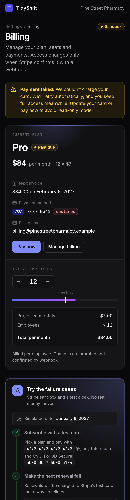
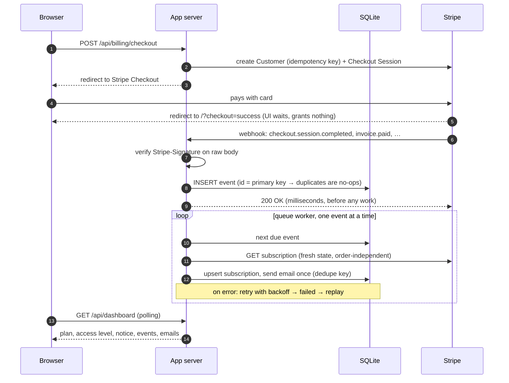

# Stripe Billing: subscriptions that stay correct

[](https://github.com/Zela0912/stripe-billing-webhooks/actions/workflows/ci.yml)   [](LICENSE)

Per-seat subscription billing for a SaaS app, built on **Stripe Checkout, the Customer Portal and webhooks**. The focus is on the part that usually breaks in production: keeping the app's idea of "who has paid" in step with Stripe when webhooks arrive **twice, late, out of order, or while your server is down**.

Built with Node.js, React, TypeScript and SQLite. It runs as a single process.

**[Live demo →](https://stripe-billing-webhooks.onrender.com/)** Subscribe with the test card `4242 4242 4242 4242`, then use the demo controls to make the next renewal fail. It runs on a free instance, so the first visit after a quiet period can take about a minute to wake up.



<p>
  
  
</p>

> **Demo data:** _TidyShift_ is a fictional shift-scheduling SaaS (the same one as in my [docs chatbot](https://github.com/Zela0912/rag-docs-chatbot)). Everything runs in a Stripe sandbox, so no real money moves.

## Why this exists

Adding a "Subscribe" button takes an afternoon. Getting the follow-up right takes longer, and the bugs cost real money: customers who paid but stay locked out, customers who stopped paying but keep access, and duplicate emails or charges. This project handles each case on purpose:

| What happens in production                              | How it's handled                                                                                                                                                                                                                   |
| ------------------------------------------------------- | ---------------------------------------------------------------------------------------------------------------------------------------------------------------------------------------------------------------------------------- |
| Someone posts a fake `invoice.paid` to your webhook URL | Every request is checked against the `Stripe-Signature` header (HMAC over the raw body, 5-minute replay window). Forged or altered requests get a 400 and change nothing.                                                          |
| Stripe delivers the same event twice                    | The event id is the primary key of the `webhook_events` table. A repeat is acknowledged, counted and skipped.                                                                                                                      |
| Two _different_ events describe the same payment        | Side effects are keyed on the business object, not the event. A payment-failed email is keyed on invoice + attempt, so the customer gets it once.                                                                                  |
| Events arrive out of order (`updated` after `deleted`)  | Handlers never copy state from the payload. They re-read the subscription from the Stripe API, so whichever event is processed last, the stored state is the current one.                                                          |
| Stripe's API is down while you process an event         | The endpoint has already stored the event and returned 200. A durable queue retries with exponential backoff, and after the last attempt the event is marked _failed_, waiting for a one-click replay.                             |
| Your server restarts with unprocessed events            | They're in the database, not in memory, so they're picked up on startup.                                                                                                                                                           |
| The customer closes the tab right after paying          | Access is granted by the webhook, never by the success redirect. The page waits for confirmation, and if the tab is gone, the webhook still does the work.                                                                         |
| Someone double-clicks "Upgrade"                         | Creating the Stripe customer uses an idempotency key, and a workspace with a live subscription can't start a second Checkout.                                                                                                      |
| A renewal payment fails                                 | The subscription goes to `past_due` and the workspace keeps full access while Stripe retries. The customer gets an email for each failed attempt and can pay from the app. Access is restricted only after every retry has failed. |
| The customer adds employees mid-period                  | The seat count is pushed to Stripe with proration, and the change is confirmed back through a webhook.                                                                                                                             |

## Features

- **Stripe Checkout** for new subscriptions: Starter and Pro, monthly or yearly (20% off), billed per employee.
- **Customer Portal** for everything after that: switching plans, updating the card, invoices, cancelling. Upgrades are charged immediately, pro rata. Downgrades and cancellations take effect at the end of the period.
- **Webhook pipeline:** verify, store, acknowledge, then process from a durable queue with retries, backoff, a dead-letter state and manual replay.
- **One access policy** in [`access.ts`](server/src/billing/access.ts) turns Stripe statuses into what the customer can do (table below). The UI and the API both read it, so they can't disagree.
- **Dunning:** "payment failed" emails per attempt, a "Pay now" button, and a read-only mode only after the final retry. Data is never deleted.
- **Live webhook pipeline and event log:** a diagram of verify → store → queue → re-sync that lights up as events arrive, counters for duplicates, retries and failures, and a filterable log where each event opens to show its id, timing, deliveries, attempts and outcome, with one-click replay.
- **Guided demo** on a Stripe test clock: subscribe, switch renewals to a card that declines, jump to the renewal date, and recover with Pay now. Each step ticks itself off.
- **Production details:**
  - Prices are referenced by lookup key, so the same code runs on any sandbox or live account.
  - Idempotent setup script for products, prices, the portal and webhook endpoints.
  - Structured JSON logs with event ids and timings.
  - Rate limiting and security headers (Helmet). Graceful shutdown.
  - Demo mode refuses to start with live keys.

## How it works



### Access rules

| Stripe status                          | Plan in the app | Access                                   | What the customer sees                          |
| -------------------------------------- | --------------- | ---------------------------------------- | ----------------------------------------------- |
| `active`, `trialing`                   | Paid plan       | Full                                     | Next renewal date, or the end date if cancelled |
| `past_due`                             | Paid plan       | Full (grace period while Stripe retries) | "Payment failed" warning, **Pay now**           |
| `unpaid`, `paused`                     | Paid plan       | Read-only                                | "Update your card to restore access"            |
| `incomplete`                           | Free            | As Free                                  | "Payment not completed"                         |
| none, `canceled`, `incomplete_expired` | Free            | Full up to 10 employees, read-only above | Upgrade prompt                                  |

These rules follow TidyShift's billing policy, which is the same policy the docs chatbot answers questions about.

## Try it

You need **Node.js 24+**, a free [Stripe account](https://dashboard.stripe.com/register) (a sandbox is enough, no business verification) and the [Stripe CLI](https://docs.stripe.com/stripe-cli).

```bash
git clone https://github.com/Zela0912/stripe-billing-webhooks.git && cd stripe-billing-webhooks
npm install
cp .env.example .env          # add your sandbox secret key (sk_test_…)
npm run stripe:setup          # creates products, prices and the portal; saves the local webhook secret
npm run dev                   # API :3002, web http://localhost:5174, and `stripe listen` forwarding webhooks
```

Then, on http://localhost:5174:

1. **Upgrade to Pro** and pay with `4242 4242 4242 4242` (any future date, any CVC). The page waits for the webhook, then shows _Active_.
2. In **Demo controls**, choose **Card that declines**, then **Advance to next renewal**. About ten seconds later the subscription is _Past due_, the warning appears and a "Payment failed" email is sent.
3. Switch back to **Working card** and click **Pay now**. Stripe charges the open invoice and `invoice.paid` restores everything.
4. Click **Replay** on any event. State is re-synced and no email is sent twice.

## Deploy

[`render.yaml`](render.yaml) is a Render Blueprint, and any Node host works the same way. Deploying takes three steps:

1. **Create a restricted key** in the Stripe Dashboard (_Developers → API keys → Create restricted key_) with Write access to Customers, Checkout Sessions, Customer portal, Subscriptions, Invoices, PaymentMethods and Test clocks, and Read access to Prices. Put it in `.env.production.local` as `STRIPE_SECRET_KEY=rk_test_…` and run `npm run stripe:check-key`. The script tries every operation the app uses on a throwaway test clock and names any permission that is missing.
2. **Deploy the Blueprint** with that key. `STRIPE_WEBHOOK_SECRET` can stay empty for now: the app starts, `/api/health` reports `"webhooks": "not_configured"`, and webhooks get a 503 that Stripe retries.
3. **Create the webhook endpoint** for the public URL with `npm run stripe:setup -- --webhook-url=https://<service>.onrender.com/api/webhooks/stripe`. The signing secret goes into `.env.production.local` (it's never printed). Copy it to the host's environment variables.

## Tests

`npm test` runs **62 tests** offline, with no Stripe account, against an in-memory fake of the Stripe API and **real signature verification**. Among them:

- forged, altered and wrongly signed webhooks are rejected
- duplicate deliveries run once; two events about one payment send one email
- out-of-order events end in the correct state
- Stripe API failures are retried with exponential backoff, end as _failed_, and replay cleanly
- events left over from a previous process are picked up
- the access policy for every subscription status
- checkout idempotency, seat sync, "Pay now" declines, and that demo controls don't exist outside demo mode

The full flow was also run end to end against a real Stripe sandbox, in a headless browser: Checkout payment, webhooks arriving out of order (`invoice.paid` before `checkout.session.completed`), a declined renewal on a test clock, recovery with "Pay now", seat changes, and the Customer Portal.

`npm run check` runs lint, typecheck, tests and the build. CI runs it on every push.

## Configuration

All settings are environment variables, validated at startup (see [`.env.example`](.env.example)).

| Variable                | Default                                          | Notes                                                                                      |
| ----------------------- | ------------------------------------------------ | ------------------------------------------------------------------------------------------ |
| `STRIPE_SECRET_KEY`     | (none)                                           | Required. `sk_test_…` locally; a restricted key (`rk_…`) for deployments                   |
| `STRIPE_WEBHOOK_SECRET` | (none)                                           | `npm run stripe:setup` writes the local one into `.env`. Until it is set, webhooks get 503 |
| `APP_URL`               | `RENDER_EXTERNAL_URL` or `http://localhost:5174` | Where Checkout and the portal send customers back                                          |
| `DEMO_MODE`             | `false`                                          | Per-visitor workspaces on test clocks, plus the demo controls. Refused with live keys      |
| `RATE_LIMIT_PER_MINUTE` | `30`                                             | Per IP, on the billing endpoints. Webhooks are not limited                                 |
| `TRUST_PROXY`           | `0`                                              | `1` behind one reverse proxy (Render, Fly.io, Railway)                                     |
| `PORT`, `DB_PATH`       | `3002`, `data/billing.db`                        |                                                                                            |

## Project structure

```
shared/billing.ts            Plans, prices, lookup keys and API types, used by server and web
server/
  src/billing/access.ts      Stripe status → plan, access level, notice (the access policy)
  src/billing/service.ts     Checkout, portal, Pay now, seats, demo controls
  src/billing/gateway.ts     The Stripe operations the app needs, as an interface
  src/billing/stripe-gateway.ts  …and their implementation with the Stripe SDK
  src/webhooks/verify.ts     Signature verification
  src/webhooks/handlers.ts   One idempotent handler per event type
  src/webhooks/queue.ts      Durable queue: retries, backoff, failed state, replay
  src/routes/                HTTP: webhook endpoint, billing API
  src/store.ts               SQLite: workspaces, subscriptions, events, emails
  scripts/setup-stripe.ts    Idempotent Stripe setup (products, prices, portal, webhooks)
  test/                      Vitest, with a fake Stripe API and real signatures
web/src/                     React billing page: plan, plans, demo controls, event log, emails
```

## Design decisions

- **Re-read, don't trust the payload.** Stripe doesn't guarantee event order, and its docs say not to use `created` to order events. Fetching the subscription costs one API call per event and removes a whole class of ordering bugs.
- **Acknowledge first, work later.** Stripe's guidance is to return 2xx before any complex logic. The queue is a table in the same database, so there is no extra infrastructure, and it survives restarts. With several app instances, the next step is a row lock (`SELECT … FOR UPDATE SKIP LOCKED` on Postgres) or a managed queue.
- **Side effects are keyed on what they're about.** Event-id deduplication stops redeliveries. A dedupe key such as `payment_failed:{invoice}:{attempt}` also stops two different events from sending the same email.
- **Stripe owns billing; the app owns access.** Plan changes, proration, cards and invoices go through Stripe's hosted pages, which handle SCA/3D Secure and PCI scope. The app keeps one function that maps a subscription to what the customer can do.
- **Stripe sits behind a small interface** (`BillingGateway`). Tests run the whole flow offline, and the rest of the code never imports the SDK.

## Going to production

The demo is deliberately complete, but a real deployment would also:

- run with a **restricted API key** limited to the resources above, and a webhook endpoint created with `npm run stripe:setup -- --webhook-url=https://…`
- use the app's existing **authentication** in place of the demo's per-browser workspace cookie
- send emails through a real provider (Postmark, SES, Resend) from the same deduplicated outbox
- use Postgres and a row-locking queue if it runs on more than one instance
- turn on Stripe's Smart Retries and choose what happens after the final retry (cancel, mark unpaid, or leave past due)

## License

[MIT](LICENSE)
